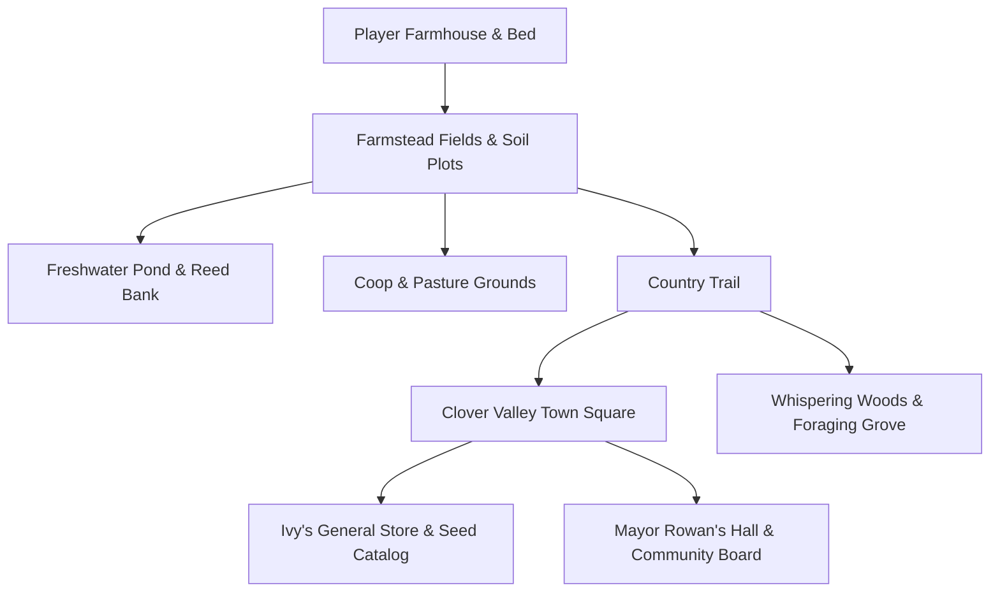

# Green Farm — Master Game Design Document 🌾📱

> **Document Version:** 1.0.0 (Master Production Specification)  
> **Status:** Authoritative Game Design & Architecture Reference  
> **Target Platform:** Mobile-First (Android / Progressive Web App / WebGL) + Desktop Web Cross-Play  
> **Engine Architecture:** Authoritative Deterministic ECS (20Hz) + PixiJS Presentation Layer  

---

## 1. Game Vision

### 1.1 What Green Farm Is
**Green Farm** is an original, mobile-first cozy farming and life simulation game. Players inherit an overgrown, sun-drenched family farmstead on the outskirts of Clover Valley. Through tactile farming, animal husbandry, seasonal rhythms, village community life, and meaningful economy loops, players transform a neglected plot of land into a thriving, self-sustaining sanctuary.

### 1.2 Target Player Experience
- **Tactile Satisfaction:** Every tap, till, sow, and harvest delivers immediate visual, haptic, and acoustic reward.
- **Cozy & Stress-Free:** No combat timers or punitive failure states. Restorative gameplay where time moves at a peaceful, predictable cadence.
- **Deep Progression:** Small daily achievements cascade into seasonal harvests, homestead expansions, upgraded livestock, and genuine community bonds.
- **Bite-Sized Yet Immersive:** Engineered for both quick 3-minute mobile check-ins (tending crops, harvesting eggs, shipping goods) and extended 45-minute evening sessions (exploring the valley, conversing with villagers, designing layouts).

### 1.3 Core Gameplay Fantasy
*"A quiet morning with soil on your hands, steam rising from your fresh coffee, roosters crowing in the distance, and the entire day ahead to cultivate your own corner of the world."*

### 1.4 What Makes Green Farm Different
1. **Authoritative Simulation Under the Hood:** Unlike shallow mobile tap-farmers that rely on ad-driven timer gates, Green Farm runs a full deterministic 20Hz biological simulation with soil moisture dynamics, nutrient recovery, deterministic RNG, and physical spatial collision.
2. **True Mobile-First UX:** Not a clumsy PC port with tiny buttons. Custom touch-first interface featuring dynamic virtual joystick, context-sensitive thumb action buttons, swipeable radial hotbar, and bottom-sheet drawers designed for one-thumb or two-thumb portrait/landscape ergonomics.
3. **Living Community Rhythm:** Villagers with observable daily schedules, distinct vocational roles, changing seasonal dialogue, and genuine reactions to your farm's contributions.
4. **Organic Visual & Acoustic Identity:** Handcrafted procedural aesthetic with soft natural color harmonies, dynamic sunbeam lighting, ambient weather particles, and synthesized organic chimes—distinct from generic mobile pixel-art clones.

### 1.5 Long-Term Progression Arc
```
[Phase I: Homestead Survivor]  -->  [Phase II: Established Farmer]  -->  [Phase III: Thriving Homestead]  -->  [Phase IV: Valley Pillar]
- 1 Tilled Plot                     - 4 Crop Varieties                 - Chicken Coop & Dairy Barn        - Automated Irrigation
- Basic Wooden Tools                - Copper Tool Upgrades             - Artisan Mayo & Cheese Presses    - Greenhouse & Orchard
- Foraging & Parsnips               - Seed Catalog Expansion           - 5 Villager Friendships           - Seasonal Festival Champion
```

---

## 2. Game World

Green Farm takes place in **Clover Valley**, an interconnected world segmented into seamless logical zones:



### 2.1 The Farmstead (Primary Zone)
- **Central Fields:** Tillable loam soil, natural grass pastures, wild weeds, fallen timber, and quarry stones.
- **The Homestead:** Player's cozy cabin featuring a rest bed, fireplace, storage chests, and kitchen counter.
- **The Water Basin:** 3x3 natural spring pond supplying water for the watering can and supporting freshwater fish.
- **Outbuilding Plots:** Dedicated leveled clearings for the Chicken Coop, Dairy Barn, and Silo.
- **The Shipping Bin:** Authoritative wooden crate at farm entrance for overnight market settlement.

### 2.2 Clover Valley Town
- **Town Square:** Paved cobblestone plaza with an ancient stone fountain, village bulletin board for daily notice quests, and seasonal festival staging.
- **Ivy's General Store:** Village shop selling staple crop seeds, fruit saplings, fertilizers, and basic homestead recipes.
- **Barnaby's Smithy:** Workshop offering tool durability and efficiency upgrades (Standard -> Copper -> Iron -> Gold).
- **The Community Hearth:** Cozy evening gathering hall where villagers socialize, eat, and relax after dusk.

### 2.3 Whispering Woods (Exploration & Foraging)
- Dense grove west of the farm rich in wild seasonal berries, mushrooms, hardwood branches, and wild herbal flowers.
- River bank area for rod fishing and collecting river stones.

---

## 3. Player Character & Action Model

### 3.1 Character Model
- **Avatar:** Stylized, charming character with directional animations (idle, walk, tool swing, water pour, celebrate).
- **Cosmetics & Customization:** Selectable hair styles, clothing colorways, and farmer hats.

### 3.2 Movement & Kinematics
- Smooth continuous 2D movement powered by velocity kinematics and obstacle collision against terrain flags (`TILE_FLAGS.WALKABLE`).
- Default speed: `6.0 tiles/second` with smooth deceleration.

### 3.3 Energy & Vitality
- **Max Energy:** `100.0` points authoritative maximum.
- **Energy Costs:** Till (8), Sow (5), Water (5), Harvest (5), Woodchop (10), Rockbreak (10).
- **Exhaustion State:** When Energy reaches 0, strenuous actions are locked. Movement remains unrestricted.
- **Energy Restoration:** Eating crops (+20 for Parsnip, +35 for Potato, +50 for Cooked Meal); sleeping overnight in bed restores to 100.

### 3.4 Tools & Equipment
| Tool | Base Tier | Upgraded Tier (Copper/Iron) | Function |
|---|---|---|---|
| **Hoe** | Wooden Hoe (1 tile) | Wide Hoe (1x3 / 3x3) | Tills grass/dirt into fertile farm plots |
| **Watering Can** | Tin Can (40 charges) | Copper Can (80 charges) | Waters tilled soil; refilled at pond |
| **Scythe** | Iron Sickle | Sweeping Scythe | Harvests mature crops; clears weeds and grass into hay |
| **Axe** | Woodcutter Axe | Forged Axe | Chops timber branches into wood materials |
| **Pickaxe** | Mining Pick | Hardened Pick | Breaks field stones into quarry rocks |
| **Fishing Rod** | Bamboo Pole | Fiberglass Rod | Casts into pond and river for aquatic fish |

---

## 4. Farming System

### 4.1 Agronomy Simulation
Farming runs on a deterministic per-tile simulation grid:
- **Moisture (0–100%):** Consumed daily by growing crops (-20% at dawn). Dry soil prevents growth; persistent drought causes wilting.
- **Fertility (0–100%):** Gradually depleted by continuous mono-cropping; restored through fallow seasons and compost.
- **Growth Stages:** Every crop progresses through 5 distinct biological stages:
  1. `Seed` (planted in tilled earth)
  2. `Sprout` (first green shoot)
  3. `Vegetative` (leafy foliage development)
  4. `Flowering / Budding` (bloom formation)
  5. `Mature` (harvest-ready with glistening aura)

### 4.2 Expanded Multi-Crop Roster
| Crop | Seed Item | Growth Time | Seed Cost | Sell Price | Preferred Season | Regrowth? |
|---|---|---|---|---|---|---|
| **Parsnip** | `seed_parsnip` | 4 Days | 20g | 35g | Spring | No |
| **Potato** | `seed_potato` | 6 Days | 50g | 80g | Spring | No (Chance for bonus drop) |
| **Cauliflower** | `seed_cauliflower` | 10 Days | 80g | 175g | Spring | No |
| **Carrot** | `seed_carrot` | 4 Days | 25g | 45g | Spring / Autumn | No |
| **Wheat** | `seed_wheat` | 4 Days | 10g | 25g | Summer / Autumn | No (Yields straw for animals) |
| **Tomato** | `seed_tomato` | 8 Days | 50g | 60g | Summer | Yes (Regrows every 3 days) |
| **Pumpkin** | `seed_pumpkin` | 12 Days | 100g | 320g | Autumn | No |

---

## 5. Animal Husbandry

### 5.1 Livestock Species
- **Chickens:**
  - Housed in the Chicken Coop (up to 4 per coop tier).
  - Feed: Hay / Wheat Straw in feeder trough or outdoor grass grazing.
  - Daily Product: **Fresh Egg** (40g base value) or **Large Golden Egg** at max happiness.
- **Dairy Cows:**
  - Housed in the Pasture Barn.
  - Daily Product: **Fresh Milk Jug** (85g base value).
- **Sheep:**
  - Produces **Soft Wool Sheaf** (150g) every 3 days using Shears.

### 5.2 Care & Happiness Mechanics
- **Petting:** Daily affection tap with floating heart animation (+15 happiness).
- **Feeding:** Grazing on sunny outdoor pasture (+20 happiness) or indoor trough feeding.
- **Shelter:** Must be called indoors before stormy weather or dark night (leaving outside drops happiness).
- **Happiness Scale (0–100):** Determines produce quality tier (Regular -> Silver -> Gold).

---

## 6. Buildings & Homestead Architecture

### 6.1 Homestead Structures
- **Farmhouse Tier 1:** Cozy 1-room cabin with bed, calendar, and bedside table.
- **Farmhouse Tier 2 Upgrade:** Expands interior with kitchen stove (cooking unlocked) and +12 storage chest slots.
- **Small Coop:** Houses up to 4 chickens. Includes hay feeding bench and nesting boxes.
- **Pasture Barn:** Houses up to 4 cows/sheep. Includes animal bell and milking stall.
- **Silo:** Automatically stores up to 240 units of hay cut from field tall grass.

---

## 7. Economy & Commerce

### 7.1 Authoritative Transaction Model
- Zero client-side wallet mutation. All gold deductions and additions occur via verified simulation commands:
  - `BUY_SEED` / `BUY_ITEM`: Immediate wallet deduction, inventory addition.
  - `SHIP_ITEM`: Produce placed in shipping bin; settled authoritatively at 06:00 dawn with `SHIPPING_SETTLED` event.
  - `UPGRADE_BUILDING`: Material and currency requirements validated atomically.

### 7.2 Balanced Pricing Matrix
- Designed for an engaging progression curve without hyperinflation:
  - Early game daily income: `70g – 200g`
  - Mid game daily income (crops + eggs + milk): `400g – 900g`
  - Building upgrades: `Coop: 2,500g + 100 Wood + 50 Stone`
  - Tool upgrades: `Copper: 1,000g + 5 Copper Bars`

---

## 8. Villager & Community System (NPCs)

### 8.1 Core Villager Cast
1. **Mayor Rowan (The Village Elder):**
   - *Personality:* Warm, proud of Clover Valley, encouraging mentor.
   - *Schedule:* Town Hall morning -> Village fountain noon -> Farm entrance on festival days.
   - *Role:* Delivers starter quests, town milestones, and festival announcements.
2. **Ivy (The Botanist Merchant):**
   - *Personality:* Cheerful, enthusiastic about soil nutrients and rare seeds.
   - *Schedule:* General Store counter (08:00–16:00) -> Forest pond evening stroll.
   - *Role:* Sells seeds, seasonal saplings, and buys forage goods.
3. **Barnaby (The Blacksmith):**
   - *Personality:* Gruff exterior with a heart of gold, passionate about forged tools.
   - *Schedule:* Smithy forge (09:00–17:00) -> Tavern porch evening.
   - *Role:* Upgrades farming tools and processes raw geode stones.

### 8.2 Dialogue & Friendship Mechanics
- **Dialogue Engine:** Contextual dialogue pools reacting to weather, season, completed quests, and friendship level.
- **Friendship Hearts (0–10 Hearts, 250 points/heart):**
  - Daily greeting: +20 points.
  - Liked gift: +45 points; Loved gift: +80 points.
  - Heart unlocks: Special cutscenes, exclusive recipes, and discount perks.

---

## 9. Quests & Valley Objectives

### 9.1 Quest Lifecycle
Every quest is an authoritative state machine:
`UNOFFERED` -> `ACTIVE` -> `READY_TO_CLAIM` -> `COMPLETED`.

### 9.2 Starter & Main Story Quests
1. **"The First Furrow":** Till 3 soil plots using the hoe. (Reward: 50g + 5 Parsnip Seeds)
2. **"Spring Planting":** Sow and water 3 seeds. (Reward: 50g + Energy restoring snack)
3. **"Bountiful First Harvest":** Harvest 3 mature crops. (Reward: 100g + 5 Potato Seeds)
4. **"Market Day":** Ship harvested produce worth at least 100g. (Reward: 150g + Fertilizer)
5. **"Meet the Valley":** Greet Rowan, Ivy, and Barnaby. (Reward: Bamboo Fishing Rod)
6. **"Feathered Friends":** Construct a Small Coop and adopt your first chicken. (Reward: 20x Animal Feed)

---

## 10. World Systems: Time, Calendar, Weather & Seasons

### 10.1 SimClock & Temporal Architecture
- **Clock Rate:** 20 simulation ticks = 1 in-game second; 1 in-game hour = 1,200 ticks (60 real seconds); 1 full day (24 hours) = 28,800 ticks (24 real minutes).
- **Dawn Transition:** Every day starts at 06:00 AM (tick 7,200 of the day). Overnight sleep fast-forwards smoothly to the next dawn.

### 10.2 Calendar & Four Seasons
- Each year consists of 4 distinct seasons: **Spring**, **Summer**, **Autumn**, **Winter**.
- Each season has 28 in-game days.
- Crops wilt if left unharvested across seasonal transitions unless greenhouse-protected.

### 10.3 Dynamic Weather States
- **Sunny / Clear:** Baseline evaporation; optimal crop photosynthesis.
- **Rainy:** Rain particles across screen; **automatically waters all outdoor tilled tiles at dawn**!
- **Stormy:** Heavy rainfall, thunder sound effects, animals must remain indoors.
- **Cloudy / Overcast:** Reduced evaporation; pleasant soft ambient lighting.

---

## 11. Mobile-First UI/UX System

### 11.1 Design Aesthetics & Palette
- **Palette:** Warm earthy cream `#fdfbf7`, deep forest sage `#2d4a27`, harvest amber `#d48817`, river teal `#2b6e7f`, and dark loam `#1f1c16`.
- **Typography:** Friendly, highly legible rounded system sans-serif (`Outfit`, `Quicksand`, or `-apple-system`).
- **Touch-First Ergonomics:** Minimum interactive hit targets of `48x48px` with `8px` thumb padding.

### 11.2 On-Screen Mobile HUD Controls
```
+-----------------------------------------------------------------------+
| [🌾 Green Farm]   [Day 1 Spring | 09:30]             [🪙 150g] [⚙️ Menu]|
| [⚡ Energy: ■■■■■■■■□□ 82/100]                                        |
|                                                                       |
|                                                                       |
|                                                                       |
|   ( L )                                                    [ Action ] |
|  Virtual                                                   [   Use  ] |
|  Joystick                                                             |
|                                                            [ Interact]|
|                                                            [    E   ] |
|   +-------------------------------------------------------+           |
|   | [1:Hoe] [2:Can] [3:Seeds] [4:Scythe] [5:Egg] [🎒 Bag] |           |
|   +-------------------------------------------------------+           |
+-----------------------------------------------------------------------+
```

1. **Virtual Dynamic Joystick:** Floating touch thumbpad on bottom-left. Touch-and-drag moves character; releases to idle.
2. **Context Action Buttons (Bottom-Right):**
   - **Primary Action (Tool Use):** Uses equipped hotbar tool on targeted tile with tactile haptic scale feedback.
   - **Context Interact (E):** Contextually displays `Talk`, `Pet`, `Open`, or `Inspect` when near an interactable entity.
3. **Scrollable Bottom Hotbar:** Displays active tools and seed stacks. Direct touch selects slot; badge indicates seed count and water charges.
4. **Cozy Bottom-Sheet Modals:** Modals (Inventory, Seed Catalog, Shipping Bin, Quests) slide in smoothly from the bottom on phones and appear as centered wooden parchment cards on tablets/desktop.

---

## 12. Audio System Architecture

### 12.1 Web Audio Synthesizer Engine
To ensure instantaneous, lightweight, offline-first audio without external asset loading delays, the audio architecture utilizes a custom procedural synthesizer:
- **UI Tap / Select:** Soft wooden click (high-Q resonant bandpass filtered noise burst).
- **Soil Tilling:** Crunchy earth rustle (low-pass filtered white noise with pitch drop).
- **Watering Splash:** Gentle aquatic bubble chime.
- **Seed Planting:** Cheerful pop.
- **Crop Harvest:** Upbeat harmonic major triad chime (`C5 - E5 - G5`).
- **Coin Settlement:** Crisp metallic coin clinks.
- **Animal Pet:** Warm soft purr/chirp.
- **Morning Rooster / Sleep:** Peaceful descending lullaby chime transitioning into cheerful dawn bell.

---

## 13. Mobile Performance & Android Packaging

### 13.1 Performance Budget
- **Target Frame Rate:** Rock-solid 60 FPS on mid-tier Android devices (e.g. Snapdragon 680 / Helio G88).
- **Draw Calls:** Batch rendering via PixiJS Container with under 35 draw calls per frame.
- **Memory Footprint:** Less than 75MB total JavaScript heap allocation.

### 13.2 Android PWA & Capacitor / Cordova Packaging
- Responsive viewport meta tag: `<meta name="viewport" content="width=device-width, initial-scale=1.0, maximum-scale=1.0, user-scalable=no, viewport-fit=cover">`.
- Offline service worker caching index bundle, textures, and web audio graph.
- Native Capacitor configuration (`capacitor.config.json`) ready for one-command Android APK generation.

---

## 14. Development Roadmap & Milestones

```
Phase 1: Master Specification & Mobile-First Cozy UI System (Current Milestone)
Phase 2: Tactile Audio Architecture & Multi-Crop Agronomy System
Phase 3: Clover Valley World Expansion & Environmental Gathering
Phase 4: Animal Husbandry Foundation (Chicken Coop & Pasture Cattle)
Phase 5: Living Village NPC Foundation & Dialogue System
Phase 6: Authoritative Quest Engine & Player Progression Milestones
Phase 7: Atmospheric Lighting, Weather Cycles & Release Polish
```

---

## 15. Green Farm 1.0 Release Criteria

Before public release, Green Farm 1.0 must fulfill:
1. **Flawless Mobile Touch Playability:** Virtual joystick and action buttons feel natural, responsive, and ergonomic.
2. **Four Complete Farming Cycles:** Multi-crop agronomy (at least 4 crops) fully playable from seed to harvest to shipping.
3. **Livestock Loop:** Functional chicken coop with daily feeding, happiness care, and egg collection.
4. **Living Town:** At least 2 fully voiced/scripted NPCs with daily schedules, dialogue, and interaction prompts.
5. **Quest Progression:** At least 5 sequential progression quests with clear HUD tracking and tangible rewards.
6. **Zero Regression:** 100% pass rate on all automated tests, zero TypeScript errors, clean production build, and reliable `localStorage` persistence surviving browser refresh.
