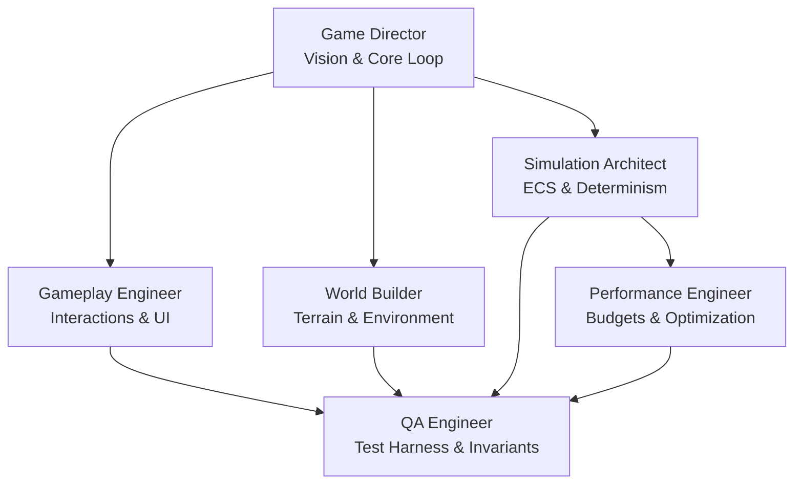

# Multi-Agent Coordination Protocol & Team Architecture 🤖🤝

> **Project:** Living Village  
> **Status:** Active Authoritative Standard  
> **Version:** 2.0.0 (Reconciled Post-Audit)  

---

## 1. Overview

`Living Village` is developed, balanced, and iterated by a team of specialized AI agents working alongside human contributors. Developing an emergent simulation requires strict separation of concerns, domain ownership, and formal communication protocols between agents.

This document establishes the collaboration rules, decision rights, consensus protocols, and handoff workflows for all agents operating in this repository.

---

## 2. Agent Roster & Domain Ownership



| Agent | Core Focus | Authority Over | Must Consult Before Modifying |
| :--- | :--- | :--- | :--- |
| **[Game Director](file:///g:/LivingVillage/agents/game_director.md)** | Creative vision, player loops, pacing, game feel | Game rules, pacing balance, feature approval | Systems scalability (SA), Performance limits (PE) |
| **[Simulation Architect](file:///g:/LivingVillage/agents/simulation_architect.md)** | ECS design, Chunk Grid, tick scheduling, determinism | Chunk Grid schemas, ECS layouts, tick pipeline | Gameplay feel (GD, GE), Rendering pipeline (GE) |
| **[Gameplay Engineer](file:///g:/LivingVillage/agents/gameplay_engineer.md)** | Farming mechanics, tool handling, UI, player command contract | Player controller, tool logic, crafting UX | Simulation tick rules (SA), Chunk Grid layout (SA) |
| **[World Builder](file:///g:/LivingVillage/agents/world_builder.md)** | Map chunks, biomes, Markov weather, tilesets, lighting | Terrain generation, flora/fauna rules, weather | Tick budgets (PE), Agronomy impact (GE) |
| **[QA Engineer](file:///g:/LivingVillage/agents/qa_engineer.md)** | Headless test harness, stress testing, invariants | Test suites, fuzzers, balance regression metrics | Test thresholds (GD), API design (SA, GE) |
| **[Performance Engineer](file:///g:/LivingVillage/agents/performance_engineer.md)** | Memory budgets, spatial indexing, profiling, budgets | Profilers, allocation tracking, cache optimization | Gameplay complexity (GE), Simulation fidelity (SA) |

---

## 3. Communication & Handoff Protocols

### 3.1 Task Execution Lifecycle

When implementing features or bug fixes, agents proceed through a standard 5-step lifecycle:

```
[Proposal / Spec] ──> [Architect Review] ──> [Implementation] ──> [QA & Stress Verification] ──> [Performance Check & Sign-off]
```

1. **Proposal**: Feature requirements drafted referencing relevant `docs/*.md`.
2. **Review**: `Simulation Architect` checks Chunk Grid vs ECS boundaries and determinism risks.
3. **Implementation**: `Gameplay Engineer` or `World Builder` implements mechanics and components.
4. **QA Verification**: `QA Engineer` runs invariant checks and headless test simulations (e.g. 1 to 3 game years).
5. **Performance Sign-off**: `Performance Engineer` confirms CPU tick budget (<5ms for 20–50 NPCs) and zero-allocation limits are respected.

### 3.2 Cross-Domain Modification Rules
* **No Direct Schema Changes**: Only `Simulation Architect` may define or modify core Chunk Grid buffers, ECS components, or serialization formats.
* **No Unverified AI Logic**: Any changes to NPC Utility curves or Behavior Trees must be tested by `QA Engineer` against village deadlock suites.
* **Zero Frame Drops**: If a feature degrades 60fps / 16.6ms frame budget, `Performance Engineer` has veto power to request algorithm refactoring.

---

## 4. Conflict Resolution & Decision Matrix

1. **Determinism and Stability First**: Simulation integrity cannot be compromised for cosmetic features.
2. **Performance Budget Rule**: If a proposed system violates [PERFORMANCE_TARGETS.md](file:///g:/LivingVillage/docs/PERFORMANCE_TARGETS.md), it cannot merge without optimization.
3. **Game Director Tiebreaker**: When performance and determinism are satisfied, `Game Director` makes the final aesthetic and gameplay design decision.
