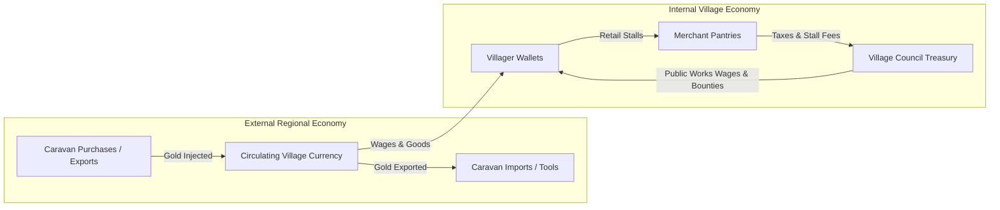

# Economy Design: Living Village 💰⚖️

> **Document Version:** 2.0.0 (Reconciled Post-Audit)  
> **Status:** Authoritative Economy Specification  
> **Owners:** [Game Director](file:///g:/LivingVillage/agents/game_director.md), [Simulation Architect](file:///g:/LivingVillage/agents/simulation_architect.md)

---

## 1. Economic Philosophy: Regulated Open Economy

The audit identified that a strictly closed-loop, zero-sum economy creates a dangerous **deflationary liquidity trap**: if money cannot be injected, any systemic friction or wealth concentration leaves common villagers unable to buy basic food, triggering artificial famines.

In `Living Village`, the economy is an **organic, regulated open market with explicit monetary sources (faucets) and sinks**:



---

## 2. Controlled Monetary Sources & Sinks

To maintain economic vibrancy without runaway hyperinflation or deflationary depression, money flows through distinct channels:

### 2.1 Monetary Injections (Sources / Faucets)
1. **Export Caravans:** Traveling merchants arrive periodically with external coin reserves to buy local agricultural and crafted surpluses (cured cheeses, dried herbs, timber).
2. **Municipal Bounties & Public Work Wages:** The village council pays wages to day laborers for clearing forest paths, maintaining bridges, and digging irrigation ditches.
3. **Traveling Visitors & Pilgrims:** Visitors spend coin at the local tavern for food and lodging.

### 2.2 Monetary Removals (Sinks)
1. **Import Caravans:** Purchasing rare exotic seeds, salt, high-grade iron, and spices exports coin to external regions.
2. **Building Permits & Infrastructure Materials:** Purchasing heavy millstones, specialized forge anvils, and construction land rights acts as an intentional money sink.
3. **Tool Degradation & Repair Fees:** Blacksmith anvil sharpening fees consume small amounts of coin.

---

## 3. Dynamic Supply-and-Demand Price Formula

Prices adjust organically based on local stockpile levels and consumption rates, but are strictly bounded by safety clamps:

$$P_{\text{current}} = \text{clamp}\left( P_{\text{base}} \times \left( \frac{D_{\text{recent}} + 1}{S_{\text{stockpile}} + 1} \right)^{\gamma} \times M_{\text{quality}}, \; 0.3 \times P_{\text{base}}, \; 3.5 \times P_{\text{base}} \right)$$

Where:
- $P_{\text{base}}$: Intrinsic base value in gold coins.
- $S_{\text{stockpile}}$: Total units currently stored in village stalls and public granaries.
- $D_{\text{recent}}$: Rolling consumption demand over the past 7 in-game days.
- $\gamma$: Elasticity coefficient ($0.35$).
- $M_{\text{quality}}$: Star quality multiplier ($1.0\times$ for Standard, $1.5\times$ for Fine, $2.0\times$ for Masterwork).
- **Safety Clamps:** Prices cannot fall below $30\%$ of base value (protecting producers) and cannot exceed $350\%$ (protecting consumers from famine).

---

## 4. Production Chains

Goods progress through authentic processing stations, increasing in value at each stage:

```
[Grain Sheaves]   ──(Thresher / Mill)──>   [Stoneground Flour]   ──(Brick Oven)──>   [Loaf of Bread]
Base: 2 Gold                               Base: 6 Gold                              Base: 14 Gold

[Flax Stalks]     ──(Spinning Wheel)──>    [Linen Yarn]          ──(Loom)────────>   [Linen Fabric]
Base: 3 Gold                               Base: 8 Gold                              Base: 20 Gold
```

---

## 5. Market Stalls & Transaction Contracts

All market transactions execute via a standardized transactional contract:

```typescript
export interface MarketTransaction {
  transactionId: number;
  tick: number;
  buyerEntityId: number;
  sellerEntityId: number;
  itemId: number;
  quantity: number;
  totalPrice: number;
}
```

- When a villager purchases food, the buyer's wallet decrements, the seller's wallet increments, and the item transfers between inventories in a single atomic transaction.
- If the buyer has insufficient funds, the transaction is rejected; the buyer may seek charity, municipal relief, or barter alternative goods.
