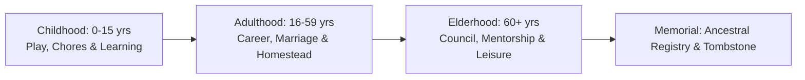

# Family Design & Lineage Systems: Living Village 👨‍👩‍👧‍👦🏛️

> **Document Version:** 2.0.0 (Reconciled Post-Audit)  
> **Status:** Authoritative Family Specification  
> **Owners:** [Game Director](file:///g:/LivingVillage/agents/game_director.md), [Simulation Architect](file:///g:/LivingVillage/agents/simulation_architect.md)

---

## 1. The Generational Life Cycle

`Living Village` supports multi-generational continuity through a streamlined life-stage progression:



### 1.1 Streamlined Age Stages

| Stage | In-Game Age | In-Game Years | Key Capabilities |
| :--- | :--- | :--- | :--- |
| **Childhood** | 0 – 15 yrs | 15 years | Follows parents, performs light foraging chores, attends village festivals. |
| **Adulthood** | 16 – 59 yrs | 44 years | Full economic independence, courtship, marriage, farming, crafting. |
| **Elderhood** | 60+ yrs | Variable | Reduced labor speed; high social respect; village council eligibility. |
| **Memorial** | Post-Mortem | Eternal | Retired from active ECS; preserved in ancestral memorial registry. |

---

## 2. Lineage Data Architecture (Sparse DAG)

Lineages are tracked via simple parent and child entity references stored directly on the entity:

```typescript
export interface LineageComponent {
  familyId: number;
  surname: string;
  parent1EntityId?: number;
  parent2EntityId?: number;
  spouseEntityId?: number;
  childrenEntityIds: number[];
}
```

- **Acyclic Graph Guarantee:** When proposing marriage or child adoption, the engine asserts that neither entity is a direct descendant or ancestor of the other, preventing cyclic family graphs.

---

## 3. Courtship & Marriage

Autonomous villagers and the player advance through simple, understandable relationship thresholds:
1. **Friendship Threshold:** Mutual `affinity >= 50`. Unlocks regular gift exchanges and companion walks.
2. **Courtship Threshold:** Mutual `affinity >= 80` and `respect >= 40`. Unlocks betrothal proposals.
3. **Marriage & Household Co-habitation:**
   - One partner moves into the other's cottage (or they move together into a newly constructed home).
   - Household funds are pooled into a shared family wallet.

---

## 4. Practical Inheritance Model

To prevent the high complexity of geometric parcel subdivision algorithms, early phases use **Direct Household Succession**:

1. **Primary Heir Succession:**
   - When an elder passes away, the primary heir is evaluated in order: `Surviving Spouse` -> `Eldest Adult Child` -> `Close Relative`.
   - The primary heir inherits the cottage, storage containers, farm parcels, and remaining bank balance.
2. **Homestead Preservation:** Parcels are not sliced into unworkable micro-slivers; the family homestead remains intact for the next generation.
3. **Secondary Heirs:** Younger adult siblings either remain as co-working residents on the family farm or save wages to clear and purchase a new homestead parcel on the village periphery.

---

## 5. Mortality & Ancestral Memorials

When an NPC passes away:
1. **ECS Despawn:** The dynamic entity is cleanly removed from the active ECS pool and spatial hash grid.
2. **Memorial Registry:** A permanent `MemorialRecord` is written to the village cemetery ledger:
   ```typescript
   export interface MemorialRecord {
     memorialId: number;
     fullName: string;
     birthTick: number;
     deathTick: number;
     notableAchievements: string[];
     familyId: number;
     tombstoneLocation: { x: number; y: number };
   }
   ```
3. **Cemetery Tombstone:** A decorative, interactive tombstone marker is placed in the village cemetery. Surviving relatives visit the marker during annual memorial days to pay respect.
