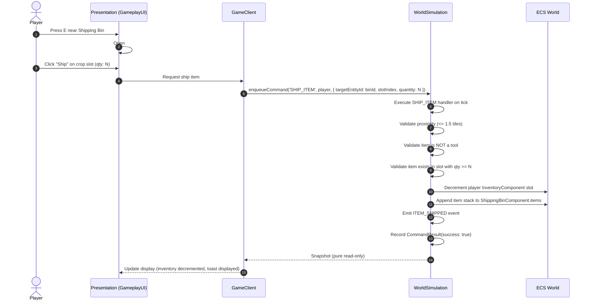
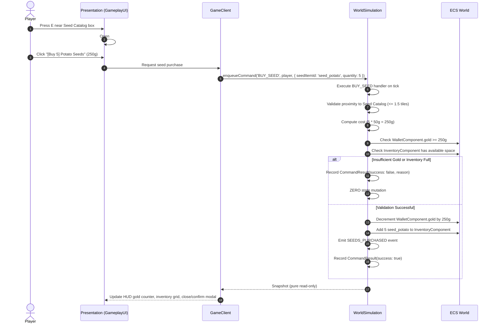

# Phase 1B-3 — Sustainable Farm Loop & Agronomy Expansion Design

> **Document Version:** 1.2.2  
> **Status:** Design Specification Awaiting Review  
> **Target Phase:** Phase 1B-3 (Homestead Repeatability, Water Renewal, Edibles & Seed Commerce)  
> **Preceding Phase:** Phase 1B-2 Step 3 (Approved & Closed)  
> **Rule:** DESIGN-ONLY document. No production code is modified or implemented.

---

## 1. Purpose of Phase 1B-3

The purpose of Phase 1B-3 is to **establish a repeatable sustainable homestead gameplay loop**.

In Phase 1B-1 and Phase 1B-2, the agricultural, energy, sleep, and UI presentation foundations were proven:
- Soil physics (moisture, fertility, fallow recovery).
- Discrete crop lifecycle (Parsnip stages 0–4).
- Core tools (Hoe, Watering Can, Seeds, Harvesting).
- Player energy foundation (costs per action, sleep restoration).
- Authoritative Bed entity & deterministic fast-forward to 06:00 dawn.
- Presentation UI, Hotbar, read-only Inventory panel, and HUD.

However, the current implementation functions as a **finite, one-way corridor**:
1. **Water Exhaustion:** The watering can starts with 40 charges. Once spent, the player can never water crops again.
2. **Resource Dead-End:** The player starts with 15 Parsnip seeds. Once planted and harvested, the player has 0 seeds and cannot farm further.
3. **No Utility for Harvested Crops:** Harvested produce sits in inventory indefinitely. Crops cannot be eaten to restore stamina, nor converted into currency or new seeds.
4. **Soil Fertility Depletion:** Each harvest drains 15 fertility, which cannot be actively replenished except by a season-long fallow rest.

Phase 1B-3 establishes the repeatable homestead loop:
$$\text{Till} \longrightarrow \text{Sow} \longrightarrow \text{Water (Renewable)} \longrightarrow \text{Harvest} \longrightarrow \begin{cases} \text{Consume (Restores Energy)} \\ \text{Ship (Earns Gold)} \longrightarrow \text{Order Seeds} \end{cases}$$

*(Note: Long-term multi-year agronomic sustainability will depend on future composting/fertilizer and seasonal calendar systems. Phase 1B-3 specifically guarantees economic and mechanical repeatability across multiple farming cycles without claiming infinite agronomic sustainability).*

---

## 2. Dependency Analysis & Relationship to Phase 2

### 2.1 Reusable Authoritative Rules
Phase 1B-3 is not an artificial blocker for Phase 2 (Autonomous Villagers), but rather **establishes reusable authoritative player-facing rules that future NPC systems should consume rather than duplicate**:
- When autonomous villagers are introduced in Phase 2 with physiological need decay (hunger, energy, sleep), they will share the exact same authoritative simulation contracts (`EnergyComponent`, `CONSUME`, `REFILL_WATER`, `InventoryComponent`, `WalletComponent`).
- Building NPC behavior on top of an incomplete agronomy loop would require creating synthetic mock actions (e.g. fake eating, unmetered water) that would inevitably require refactoring.
- Standardizing water replenishment, food consumption, and crop exchange at the homestead level ensures homogeneous rules across all entities.

### 2.2 Relationship to Phase 3 (Open Economy)
Phase 3 defines regional supply/demand curves, caravan faucets/sinks, price elasticity, and artisanal processing chains. Introducing dynamic macroeconomic price elasticity before the player can even buy a packet of seeds at their farmstead is premature optimization. The homestead Shipping Bin provides the minimal, atomic transactional foundation (`WalletComponent`, base item values, overnight settlement) upon which the Phase 3 village marketplace will build.

---

## 3. Exact Scope of Phase 1B-3

### 3.1 Included in Phase 1B-3:
1. **Water Source Proximity & Watering Can Refilling (`REFILL_WATER`):**
   - Natural water tiles (`TILE_FLAGS.WATER`) act as infinite water sources.
   - Refilling validates proximity ($\le 1.5$ tiles reach) to a water tile.
   - Restores watering can charges to `WATERING_CAN_MAX_CHARGES` (40).
   - Deducts 1 energy (`PLAYER_CONFIG.REFILL_WATER`).
2. **Crop Consumption for Energy (`CONSUME`):**
   - Player can consume harvested edible crops (e.g. `crop_parsnip`) from hotbar/inventory.
   - Decrements stack quantity by 1.
   - Restores configured energy (+20 energy, clamped to `max`).
3. **Farmstead Shipping Bin & Overnight Settlement (`SHIP_ITEM`):**
   - Authoritative `ShippingBin` entity spawned on the homestead (adjacent to house/bed).
   - Player deposits harvested produce into the bin during the day.
   - During overnight fast-forward (at 06:00 dawn in `advanceSimulationTo()`), shipped produce is tallied at fixed base prices and credited to the player's wallet.
4. **Seed Order Cache / Farmstead Catalog (`BUY_SEED`):**
   - Farmstead order box entity allowing the player to purchase seed packets using gold.
   - Deducts gold from `WalletComponent`, places seeds in `InventoryComponent`.
5. **Crop Roster Expansion (Potato & Cauliflower):**
   - Adds **Potato** (6 days, medium investment) and **Cauliflower** (12 days, high capital investment).
   - Validates that `CropRegistry` handles multiple distinct growth curves, seed prices, and harvest yields without seasonal restrictions.
6. **Authoritative Farmstead Layout Initializer (`FarmsteadLayout`):**
   - Specification for a shared, deterministic layout module (`src/world/FarmsteadLayout.ts`) to be implemented during Step 1.
7. **Presentation Exposure & UI:**
   - Gold display on HUD (`🪙 100g`).
   - Shipping Bin modal (`[E] Deposit Produce`).
   - Seed Catalog modal (`[E] Order Seeds`).

### 3.2 Explicitly Out of Scope:
- **NO NPCs or Villager AI:** No NPC schedules, dialogues, or relationships.
- **NO Dynamic Supply/Demand:** Static integer prices only.
- **NO Village Market Stalls or Caravans:** Only the homestead shipping bin and catalog order box.
- **NO Currency Sinks Other Than Seeds:** No taxes, rent, building construction fees, or tool repairs.
- **NO Cooking System:** Raw harvested crops restore modest energy directly.
- **NO Fertilizer Crafting:** Defer composting until biomass/weed systems are introduced.
- **NO Weather System or Seasons:** Continues using `SimpleEnvironmentProvider`. No seasonal planting restrictions.
- **NO Tool Upgrades:** Hoe and Watering Can remain standard.
- **NO Inventory Expansion:** Inventory remains 10 slots.

---

## 4. Economic Sanity Check (Static Initial Tuning)

All item prices and energy values are deterministic compile-time constants centralized in `ECONOMY_CONFIG`. These values represent initial tuning constants to ensure a functional early-game progression, not a balanced final economy. No dynamic supply/demand formulas or seasonal multipliers are implemented.

### Initial Crop Economy Table:
| Item | Seed Buy Price | Growth Days | Harvest Yield | Sell Price | Min Gross Revenue | Max Gross Revenue | Gross Profit | Harvest Units to Break Even | Profit / Day | Energy Restored |
| :--- | :---: | :---: | :---: | :---: | :---: | :---: | :---: | :---: | :---: | :---: |
| **Parsnip** | 20g | 4 days | 1 unit | 35g | 35g | 35g | +15g | 1 unit | 3.75g/day | +20 |
| **Potato** | 50g | 6 days | 1 unit | 80g | 80g | 80g | +30g | 1 unit | 5.00g/day | +25 |
| **Cauliflower** | 80g | 12 days | 1 unit | 175g | 175g | 175g | +95g | 1 unit | 7.92g/day | +40 |

### Sanity Check Analysis:
- **Zero RNG Yield:** Each mature tile yields exactly 1 harvested crop unit in Phase 1B-3, eliminating economic variance.
- **Positive Net Margins:** Every crop yields positive gross profit upon harvest ($+15$g, $+30$g, $+95$g).
- **Investment vs. Velocity Tradeoff:**
  - Parsnip offers rapid capital velocity (4 days, 3.75g/day) with low capital risk (20g).
  - Potato offers intermediate progression (6 days, 5.00g/day) at medium capital commitment (50g).
  - Cauliflower offers the highest daily yield (12 days, 7.92g/day) but requires substantial upfront capital (80g) and patience.
- **Immediate Break-Even:** Because yield is 1 unit and sell price exceeds seed price, selling the harvested unit immediately recovers the seed investment with profit.

---

## 5. Soil Fertility Baseline & Values

The simulation retains all previously approved soil fertility balance constants defined in `FARMING_CONFIG`:
- **Natural Baseline Fertility:** `FARMING_CONFIG.BASELINE_FERTILITY = 50`.
- **Fallow Season Recovery Constant:** `FARMING_CONFIG.FALLOW_FERTILITY_RECOVERY = 15`. `FALLOW_FERTILITY_RECOVERY` remains an existing configuration value. Triggering fertility recovery through seasonal/calendar logic is outside Phase 1B-3 because seasons are out of scope.
- **Crop Fertility Consumption:**
  - Parsnip: `FARMING_CONFIG.PARSNIP_FERTILITY_CONSUMPTION = 15`.
  - Potato: `15`.
  - Cauliflower: `20`.
- **Plot Initial Fertility:** In Phase 1B-3, farm plots start at baseline fertility `50`. No arbitrary 60–90 fertility ranges are introduced.
- **Plot Reuse across Cycles:** Cycle 2 deterministically reuses 4 of the 5 plots used during Cycle 1. Therefore, the fertility progression applies directly to those reused plots:
  $$\text{Initial Fertility: } 50 \xrightarrow{\text{Parsnip Harvest (-15)}} 35 \xrightarrow{\text{Potato Harvest (-15)}} 20$$
  Over the two acceptance cycles, farm plot fertility remains comfortably positive ($50 \rightarrow 35 \rightarrow 20$). Full multi-cycle fertility regeneration is deferred to future composting/fertilizer and calendar systems.

---

## 6. Starting Gold & Save/Load Migration Contract

### 6.1 Authoritative Starting Gold
Centralize the starting gold constant in `src/economy/EconomyConfig.ts`:
```typescript
export const ECONOMY_CONFIG = {
  STARTING_GOLD: 100
} as const;
```
Upon spawning a new player character (`sim.spawnPlayer()`), the player's `WalletComponent` is initialized with:
```typescript
{ gold: ECONOMY_CONFIG.STARTING_GOLD } // exactly 100g
```

### 6.2 Migration Contract for Older Saves
When deserializing a save snapshot (such as a Phase 1B-2 snapshot where `WalletComponent` does not exist):
- If `WalletComponent` is missing for `playerEntityId`, the deserializer/restoration routine automatically attaches `WalletComponent` with `gold = ECONOMY_CONFIG.STARTING_GOLD` (100g).
- Existing player inventory, energy, and world tiles remain completely uncorrupted.

---

## 7. Authoritative Farmstead Layout Specification (Future Implementation)

### 7.1 Status Notice
*NOTE: `src/world/FarmsteadLayout.ts` is NOT implemented in this design document. It will be implemented during Phase 1B-3 Step 1.*

### 7.2 Authoritative Future Responsibilities:
1. **Deterministic Water Source Tiles:** Carves a $3\times 3$ natural water pond at coordinates `(22, 7)` to `(24, 9)` on chunk (0, 0), setting `terrainType = 4` (Water), `flags = TILE_FLAGS.WATER`, and `moisture = 100`.
2. **Bed Entity Placement:** Spawns bed entity at `(12, 12)` with `BedComponent`.
3. **Shipping Bin Entity Placement:** Spawns shipping bin entity at `(14, 12)` with `ShippingBinComponent`.
4. **Seed Catalog Entity Placement:** Spawns seed catalog entity at `(15, 12)` with `SeedCatalogComponent`.
5. **Player Spawn Placement:** Spawns player entity at `(16, 16)` with standard starting equipment and 100g.
6. **Architectural Role:** Shared directly by browser startup (`src/client/main.ts`) and headless integration tests (`SustainableLoopScenario.test.ts`) to guarantee identical, deterministic world setup without procedural world generation or browser DOM dependencies.

---

## 8. Exact Crop Growth Timing & Deterministic Tests

In the authoritative `FarmingSystem.ts`, active crops progress strictly during the **06:00 AM daily dawn evaluation**:
1. If `tile.moisture >= cropDef.dailyMoistureNeed`, `tile.growthDays` increments by 1 and hydration is consumed.
2. If `tile.growthDays >= cropDef.stageDays[tile.cropStage]`, `tile.cropStage` increments by 1 and `tile.growthDays` resets to 0.
3. When `tile.cropStage === 3`, the crop reaches **Mature** and is eligible for harvest.

### Exact Progression Timelines:

#### Parsnip (`totalDaysToMature = 4`, `stageDays = [1, 1, 2]`):
- **Sown Day 1:** Planted in tilled, hydrated soil (`cropStage = 0`, `growthDays = 0`).
- **Dawn 1 (Day 2 06:00):** Hydrated $\rightarrow$ `growthDays = 1` ($\ge 1$) $\rightarrow$ **Stage 1 (Sprout)**, `growthDays = 0`.
- **Dawn 2 (Day 3 06:00):** Hydrated $\rightarrow$ `growthDays = 1` ($\ge 1$) $\rightarrow$ **Stage 2 (Growing)**, `growthDays = 0`.
- **Dawn 3 (Day 4 06:00):** Hydrated $\rightarrow$ `growthDays = 1` ($< 2$) $\rightarrow$ Remains **Stage 2 (Growing)**, `growthDays = 1`.
- **Dawn 4 (Day 5 06:00):** Hydrated $\rightarrow$ `growthDays = 2` ($\ge 2$) $\rightarrow$ **Stage 3 (Mature)**!
*Parsnip is harvestable on Day 5 at 06:00 AM dawn (exactly 4 hydration dawns).*

#### Potato (`totalDaysToMature = 6`, `stageDays = [1, 2, 3]`):
- **Sown Day 6:** Planted in tilled, hydrated soil (`cropStage = 0`, `growthDays = 0`).
- **Dawn 1 (Day 7 06:00):** Hydrated $\rightarrow$ `growthDays = 1` ($\ge 1$) $\rightarrow$ **Stage 1 (Sprout)**, `growthDays = 0`.
- **Dawn 2 (Day 8 06:00):** Hydrated $\rightarrow$ `growthDays = 1` ($< 2$) $\rightarrow$ Remains **Stage 1 (Sprout)**, `growthDays = 1`.
- **Dawn 3 (Day 9 06:00):** Hydrated $\rightarrow$ `growthDays = 2` ($\ge 2$) $\rightarrow$ **Stage 2 (Growing)**, `growthDays = 0`.
- **Dawn 4 (Day 10 06:00):** Hydrated $\rightarrow$ `growthDays = 1` ($< 3$) $\rightarrow$ Remains **Stage 2 (Growing)**, `growthDays = 1`.
- **Dawn 5 (Day 11 06:00):** Hydrated $\rightarrow$ `growthDays = 2` ($< 3$) $\rightarrow$ Remains **Stage 2 (Growing)**, `growthDays = 2`.
- **Dawn 6 (Day 12 06:00):** Hydrated $\rightarrow$ `growthDays = 3` ($\ge 3$) $\rightarrow$ **Stage 3 (Mature)**!
*Potato is harvestable on Day 12 at 06:00 AM dawn (exactly 6 hydration dawns).*

#### Cauliflower (`totalDaysToMature = 12`, `stageDays = [2, 4, 6]`):
- Matures after exactly 12 hydration dawns (harvestable on Day 13 at 06:00 AM dawn if sown Day 1).

### Mandatory Crop Timing Tests:
Implementation must include deterministic unit/integration tests in `tests/farming/CropGrowthTiming.test.ts` asserting each stage transition at the exact tick for Parsnip, Potato, and Cauliflower.

---

## 9. Authoritative Input & Action Semantics

### 9.1 Watering Semantics & Can Charge Consumption
- **Precondition:** A tile is valid for `WATER` if `tile.terrainType === 2` (Tilled Soil) or `tile.cropTypeId > 0`.
- **Hydration Cap:** Adding water increases `tile.moisture` by `WATERING_CAN_MOISTURE_AMOUNT` (40), clamped to 100.
- **Charge Consumption Invariant:** Each valid `WATER` command on an eligible tile consumes exactly 1 charge and `PLAYER_CONFIG.WATER` energy (1 energy).
- **Empty Can Invariant:** If `wateringCan.charges <= 0`, `WATER` strictly rejects with `'Watering can empty'`, causing zero state mutation and zero energy deduction.
- **Refill Semantics:** Executing `REFILL_WATER` adjacent to a water tile (`flags & TILE_FLAGS.WATER !== 0`) restores charges to `WATERING_CAN_MAX_CHARGES` (40) and deducts 1 energy.
- **No Exploit Watering:** Watering is restricted to legitimate plots needing hydration; repeated watering on saturated tiles is not permitted as an exploit to dump water.

### 9.2 Input Bindings:
| Action | Primary Input Trigger | Context / Preconditions |
| :--- | :--- | :--- |
| **`CONSUME`** | **`C` Key** | Selected hotbar slot contains an edible item (`energyRestored !== undefined`). |
| **`REFILL_WATER`** | **Left-Click Water Tile** (or **`E` Key**) | Selected hotbar slot is `tool_watering_can`, and target tile is within reach ($\le 1.5$ tiles) with `TILE_FLAGS.WATER`. |
| **Open Shipping Bin Modal** | **`E` Key** | Player is within reach ($\le 1.5$ tiles) of `ShippingBin` entity. |
| **Open Seed Catalog Modal** | **`E` Key** | Player is within reach ($\le 1.5$ tiles) of `SeedCatalog` entity. |
| **Purchase Quantity Selection** | **Dedicated `[Buy 1]` and `[Buy 5]` Buttons** | Inside the Seed Catalog modal UI. |

---

## 10. Authoritative Transaction & Mutation Flows

### 10.1 Shipping Transaction Flow

*Crucial Constraint:* The UI never calculates or directly mutates inventory or shipping bin state.

### 10.2 Seed Purchase Flow


---

## 11. Overnight Settlement Boundary Execution Order

Overnight settlement executes strictly within `WorldSimulation.advanceSimulationTo()` (and `step()`) when the simulation advances across the 06:00 dawn tick boundary:
1. **Hourly Soil Evaporation:** Standard moisture reduction on exposed tiles.
2. **Shipping Bin Settlement:**
   - Query all entities with `ShippingBinComponent`.
   - Calculate total revenue: $\text{TotalRevenue} = \sum (\text{item}_i.\text{quantity} \times \text{sellPrice})$.
   - Credit `player.wallet.gold += TotalRevenue`.
   - Clear shipping bin: `bin.items = []`.
   - Emit `SHIPPING_BIN_SETTLED` event (`{ actorEntityId, totalRevenue, itemsSold }`).
3. **Daily Dawn Crop Growth:** Evaluate watered status, increment growth days, transition crop stages.
4. **Command Result Expiration:** Expire stale results older than 20 ticks.

---

## 12. Transaction Invariants

1. **Non-Negative Gold:** `wallet.gold >= 0` at all times. Fractional gold is impossible.
2. **Non-Negative Item Quantities:** `item.quantity >= 1` for any slot containing an item.
3. **Bounded Watering Can:** `wateringCan.charges` is strictly bounded $[0, 40]$.
4. **Transaction Atomicity (Zero Mutation on Failure):**
   - If `gold < cost`, `BUY_SEED` mutates neither gold nor inventory.
   - If inventory is full, `BUY_SEED` mutates neither gold nor inventory.
   - If player is too far from bin, `SHIP_ITEM` mutates neither inventory nor shipping bin.
   - If non-edible item is targeted, `CONSUME` mutates neither energy nor inventory.
5. **Tool Protection:** Items with `itemId.startsWith('tool_')` can **never** be deposited into the Shipping Bin.
6. **Edible Only:** Items without `energyRestored` in their definition cannot be consumed.
7. **Snapshot Purity:** `getRenderSnapshot()` remains strictly observational/read-only with zero mutations.

---

## 13. Save / Load & Migration Tests

The persistence test suite must explicitly assert:
1. **Migration Compatibility:** Loading a Phase 1B-2 save (lacking `WalletComponent`) attaches `WalletComponent` with `gold = ECONOMY_CONFIG.STARTING_GOLD` (100g) without corrupting existing player or chunk data.
2. **Wallet Persistence:** Roundtrip save/load preserves exact gold amount (e.g. 240g $\rightarrow$ save $\rightarrow$ load $\rightarrow$ 240g).
3. **Shipping Bin Persistence:** Items deposited mid-day inside the shipping bin persist across save/load before dawn settlement.
4. **Watering Can Persistence:** Refilled or partially used watering can charges persist across save/load.
5. **Deterministic Continuation:** Continuing simulation for 1,000 ticks after save/load produces bit-for-bit identical state compared to continuous un-saved execution.

---

## 14. Performance Targets

- **Established Architecture Target:** $\le 5.0\text{ ms}$ per 20Hz simulation tick (for the initial 20–50 NPC baseline).
- **Current Measured Baseline (Phase 1B-2):** $\approx 0.0368\text{ ms}$ to $0.0430\text{ ms}$ per tick.
- **Expected Phase 1B-3 Overhead:**
  - `REFILL_WATER`, `CONSUME`, `SHIP_ITEM`, `BUY_SEED` are single-tick lookups executing in $< 0.01\text{ ms}$.
  - Overnight settlement sums 1–10 stacks in the shipping bin in $< 0.02\text{ ms}$ once per 24 in-game hours.
  - Overall average simulation tick will remain well below $0.1\text{ ms}$, comfortably meeting the $\le 5.0\text{ ms}$ target.

---

## 15. Measurable Acceptance Criteria: Two Complete Repeatable Homestead Cycles

Phase 1B-3 acceptance requires the execution of an automated integration scenario validating **two complete repeatable homestead cycles** with exact watering, energy, and fertility tracking:

### Cycle 1 (Parsnip Lifecycle & Liquidity):
1. **Initial Setup (Day 1):** Setup via `FarmsteadLayout` (pond at `(22-24, 7-9)`, bed, bin, catalog). Player starts with 15 Parsnip seeds, 100g, Hoe, Watering Can (40 charges), 100 Energy. Farm plots start at baseline fertility `50`.
2. **Day 1 Actions:**
   - Player tills 5 plots (cost: $5 \times 5 = 25$ energy). Energy: $100 - 25 = 75$.
   - Player sows 5 Parsnip seeds (cost: $5 \times 2 = 10$ energy). Energy: $75 - 10 = 65$.
   - Player waters 5 plots (cost: $5 \times 1 = 5$ energy, 5 charges). Energy: $65 - 5 = 60$. Can charges: $40 - 5 = 35$.
   - Player sleeps. Fast-forward to Day 2 06:00 dawn. Energy restores to 100.
3. **Day 2–4 Daily Watering:**
   - Day 2: Waters 5 plots (5 charges, 5 energy). Can charges: $35 - 5 = 30$. Sleep.
   - Day 3: Waters 5 plots (5 charges, 5 energy). Can charges: $30 - 5 = 25$. Sleep.
   - Day 4: Waters 5 plots (5 charges, 5 energy). Can charges: $25 - 5 = 20$. Sleep.
   *(Total waterings in Cycle 1: exactly 20 valid waterings. Charges remaining: 20).*
4. **Day 5 (Harvest, Consumption & Shipping):**
   - At Day 5 06:00 dawn (4 hydration dawns elapsed), Parsnips reach Stage 3 Mature.
   - Player harvests 5 Parsnips: cost is $-10$ energy total ($5 \times 2 = 10$). Energy: $100 - 10 = 90$.
   - Plot fertility on the 5 harvested plots drops from 50 to $50 - 15 = 35$.
   - Player consumes 1 Parsnip (`CONSUME`): restores $+20$ energy. Net energy change on Day 5: $-10 + 20 = +10$ energy. Energy reaches 100 (capped at 100 max). Inventory stack decrements from 5 to 4 Parsnips.
   - Player deposits 4 Parsnips into Shipping Bin (`SHIP_ITEM`, 0 energy).
   - Player sleeps. Fast-forward to Day 6 06:00 dawn. Energy restores to 100.
5. **Day 6 (Overnight Settlement & Seed Purchase):**
   - Dawn settlement tallies $4 \times 35\text{g} = 140\text{g}$.
   - Player wakes with $100\text{g} + 140\text{g} = 240\text{g}$. Shipping bin is empty.
   - Player opens Seed Catalog and buys 4 Potato seeds ($4 \times 50\text{g} = 200\text{g}$). Remaining gold: 40g. 4 Potato seeds placed in inventory.

### Cycle 2 (Potato Lifecycle, Exhaustion, Refill & Expansion):
6. **Day 6 Planting (Reusing 4 Cycle-1 Plots):**
   - Player deterministically reuses 4 of the 5 plots harvested in Cycle 1 (current fertility: 35).
   - Player tills 4 plots (cost: $4 \times 5 = 20$ energy). Energy: $100 - 20 = 80$.
   - Player sows 4 Potato seeds (cost: $4 \times 2 = 8$ energy). Energy: $80 - 8 = 72$.
   - Player waters 4 plots (cost: $4 \times 1 = 4$ energy, 4 charges). Energy: $72 - 4 = 68$. Can charges: $20 - 4 = 16$.
   - Player sleeps. Fast-forward to Day 7 06:00 dawn. Energy restores to 100.
7. **Day 7–10 Daily Watering (Draining Can Legitmately):**
   - Day 7: Waters 4 plots (4 charges, 4 energy). Can charges: $16 - 4 = 12$. Sleep.
   - Day 8: Waters 4 plots (4 charges, 4 energy). Can charges: $12 - 4 = 8$. Sleep.
   - Day 9: Waters 4 plots (4 charges, 4 energy). Can charges: $8 - 4 = 4$. Sleep.
   - Day 10: Waters 4 plots (4 charges, 4 energy). Can charges: $4 - 4 = 0$! Sleep.
   *(At Day 10 night, exactly 40 legitimate waterings have occurred: 20 in Cycle 1 + 20 in Cycle 2. Can charges = 0).*
8. **Day 11 (Empty Can Invariant & Water Renewal):**
   - Player attempts `WATER` on a plot with 0 charges. Command strictly FAILS with `'Watering can empty'`. Zero energy deducted, zero tile mutation.
   - Player moves within 1.5 tiles of pond at `(22, 7)` and executes `REFILL_WATER`. Energy deducts 1 ($100 - 1 = 99$). Can charges restored to 40.
   - Player waters 4 plots (cost: 4 energy, 4 charges). Energy: $99 - 4 = 95$. Can charges: $40 - 4 = 36$.
   - Player sleeps. Fast-forward to Day 12 06:00 dawn. Energy restores to 100.
9. **Day 12 (Harvest & Shipping Cycle 2):**
   - At Day 12 06:00 dawn (6 hydration dawns elapsed), Potatoes reach Stage 3 Mature.
   - Player harvests 4 Potatoes (cost: $4 \times 2 = 8$ energy). Energy: $100 - 8 = 92$.
   - Plot fertility on the 4 reused plots drops from 35 to $35 - 15 = 20$.
   - Player deposits 4 Potatoes into Shipping Bin (`SHIP_ITEM`, 0 energy).
   - Player sleeps. Simulation advances to Day 13 06:00 dawn.
10. **Day 13 (Final Settlement & Economic Result):**
    - Dawn settlement tallies $4 \times 80\text{g} = 320\text{g}$.
    - Player wakes with $40\text{g} + 320\text{g} = 360\text{g}$.
11. **System Invariant Validation:**
    - Fertility Sequence on Reused Plots: Exactly $50 \rightarrow 35 \rightarrow 20$.
    - Determinism: 10,000 tick simulation run produces bit-for-bit identical hashes across independent runs.
    - Observational Purity: `getRenderSnapshot()` produces identical output without mutating simulation state.
    - Zero Failure Regressions: All 106 existing tests continue to pass.

---

## 16. Phased Implementation Breakdown (Three Steps)

```
┌────────────────────────────────────────────────────────┐
│ Phase 1B-3 Step 1: Water Renewal & Food Consumption    │
│ • FarmsteadLayout initializer (pond, entities)         │
│ • REFILL_WATER command + water tile reach validation   │
│ • CONSUME command ('C' key) + food energy recovery     │
│ • Focused unit & invariant tests                       │
└───────────────────────────┬────────────────────────────┘
                            │
┌───────────────────────────▼────────────────────────────┐
│ Phase 1B-3 Step 2: Farmstead Commerce Foundation       │
│ • WalletComponent on player (STARTING_GOLD = 100)      │
│ • ShippingBin entity + dawn settlement in fast-forward │
│ • SeedCatalog order box entity + BUY_SEED command      │
│ • Save/load migration & determinism tests              │
└───────────────────────────┬────────────────────────────┘
                            │
┌───────────────────────────▼────────────────────────────┐
│ Phase 1B-3 Step 3: Crop Roster, UI & Two-Cycle Loop    │
│ • Potato & Cauliflower definitions in CropRegistry     │
│ • HUD Gold display & Shipping/Catalog modals           │
│ • Two-Cycle Sustainability Acceptance Scenario test    │
│ • Review hardening pass                                │
└────────────────────────────────────────────────────────┘
```

---

*This document is the authoritative design specification for Phase 1B-3 v1.2.2. No production code has been modified or implemented.*

**STOPPING HERE for review and approval.**
