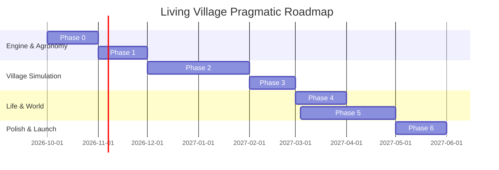

# Development Roadmap: Living Village 🗺️🚀

> **Document Version:** 2.0.0 (Reconciled Post-Audit)  
> **Status:** Active Authoritative Roadmap  
> **Owners:** [Game Director](file:///g:/LivingVillage/agents/game_director.md), [Simulation Architect](file:///g:/LivingVillage/agents/simulation_architect.md)

---

## 1. Milestone Overview & Strategic Phasing

The development roadmap is structured into 7 pragmatic phases, prioritizing immediate core gameplay feel and simulation stability before introducing scaling or multi-village mechanics:

---

## 2. Detailed Milestone Deliverables

### Phase 0: Engine Foundations & Core Contracts (Month 1)
- [x] Phase 0 Architecture Audit and specification reconciliation.
- [ ] Implement deterministic 20Hz tick runner with time accumulator.
- [ ] Implement dual memory architecture:
  - **Chunk Grid System** (32x32 tiles: terrain, moisture, fertility, crops).
  - **Sparse-Set ECS** for dynamic entities.
- [ ] Implement flat 4m spatial hash grid for dynamic entity proximity queries.
- [ ] Implement deterministic Grid A* pathfinder with request queue.
- [ ] Implement direct authoritative chunk snapshot save/load serializer.
- [ ] Implement headless Node.js test harness verifying 1-year stability.

### Phase 1: Agronomy, Soil & Tactile Player Controls (Month 2)
- [ ] Player controller executing authoritative `PlayerCommand` pipeline.
- [ ] Soil simulation: Moisture (0-100) and Fertility (0-100) on Chunk Grid.
- [ ] Core farming tools: Hoe (till), Watering Can (water), Seed Bag (sow), Sickle (harvest).
- [ ] Initial roster of 8 staple crops across 5 discrete growth stages (`Seed` to `Wilted`).
- [ ] Companion planting synergies (e.g. Three Sisters moisture & fertility bonuses).

### Phase 2: Autonomous Villagers & Behavior Trees (Month 3–4)
- [ ] 20–50 autonomous NPC population running at homogeneous 20Hz.
- [ ] Physiological need decay (Hunger, Energy, Social).
- [ ] 8 discrete personality traits modifying utility response curves.
- [ ] Deterministic Behavior Tree execution for daily routines (farm, eat, rest).
- [ ] Sparse relationship model (`Affinity`, `Respect`) with family and player.
- [ ] Central World Event History with localized known-event propagation.

### Phase 3: Regulated Open Economy & Production Chains (Month 5)
- [ ] Dynamic supply-and-demand price determination with safety clamps ($0.3\times$ to $3.5\times$).
- [ ] Intentional monetary faucets (export caravans, public wages) and sinks (imports, repair fees).
- [ ] Artisanal crafting stations (Windmill, Quern, Smokehouse, Brick Oven, Loom).
- [ ] Weekly village market stalls and merchant trade caravan arrivals.

### Phase 4: Family Lineages & Generational Legacy (Month 6)
- [ ] Streamlined aging progression (Childhood -> Adulthood -> Elderhood -> Memorial).
- [ ] Courtship thresholds, marriage, and shared household budgets.
- [ ] Directed Acyclic Graph (DAG) family lineage tracking.
- [ ] Direct household succession inheritance (preserving family homesteads).
- [ ] Village cemetery memorials and ancestral gravestone interactions.

### Phase 5: World Generation, Biomes & Markov Weather (Month 7)
- [ ] Procedural chunk generation with elevation, river waterways, and biomes.
- [ ] Deterministic seasonal Markov weather state machine (Clear, Cloudy, Rain, Storm, Heatwave).
- [ ] Dynamic day/night celestial lighting transitions and ambient particles.
- [ ] Settlement expansion: Clearing peripheral plots for new married couples.

### Phase 6: Polish, Accessibility & Release Readiness (Month 8)
- [ ] Dynamic sound design and acoustic ambiance.
- [ ] Controller support (Gamepad, Steam Deck) and key remapping.
- [ ] High-contrast accessibility overlays and UI scaling.
- [ ] 3-Year headless Monte Carlo stress testing for economic and demographic balance.
